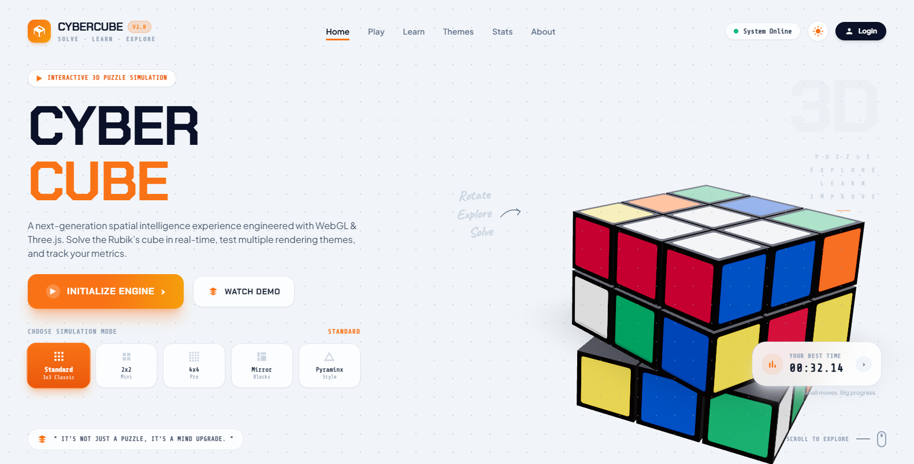
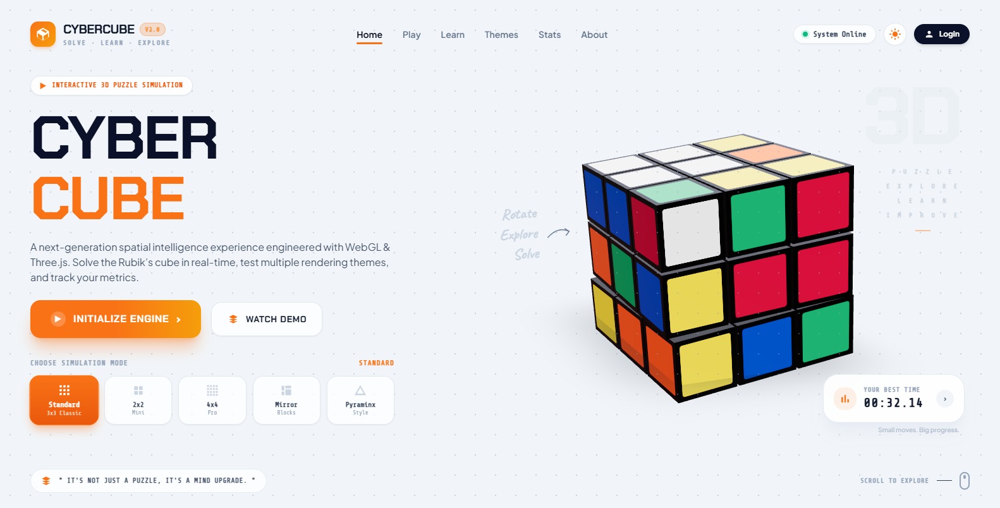

# 🧩 CyberCube — 3D Interactive Rubik's Cube Simulation

<div align="center">

[](https://threejs.org/)
[](https://react.dev/)
[](https://vitejs.dev/)
[](https://greensock.com/)
[](LICENSE)

A next-generation spatial puzzle experience engineered with React, Three.js, and WebGL. Solve Rubik's cubes in real-time, test multiple simulation modes (3x3, 2x2, 4x4, Mirror Blocks), and track your speed metrics.

<br/>



</div>

---

## 📸 Previews

| Interactive 3D Puzzle | Spatial Engine Simulation |
| :---: | :---: |
|  |  |
| **CyberCube Engine Dashboard** | **Real-Time Slice Rotation & Physics** |

---

## ✨ Features

- 🎲 **Multiple Puzzle Modes**: Switch between Standard 3x3, 2x2 Mini, 4x4 Pro, Mirror Blocks, and Pyraminx styles.
- 🕹️ **Smooth 3D Drag & Slice Rotation**: Natural touch/mouse gesture interaction for rotating faces and orbiting the cube.
- ⏱️ **Timer & Solve Analytics**: Built-in speedcubing timer with best-time tracking and move counters.
- 🎨 **Futuristic Cyber HUD**: Clean cyberpunk design with light/dark theme toggles and sound effects.
- ⚡ **GPU Accelerated**: Built on `@react-three/fiber` and `@react-three/drei` for 60 FPS performance.

---

## 🎮 Controls

| Action | Control |
| :--- | :--- |
| **Rotate Face / Slice** | Click and drag along any cube face row or column |
| **Orbit Camera** | Click and drag on the empty canvas background |
| **Zoom View** | Mouse wheel or trackpad scroll |
| **Switch Puzzle Mode** | Click any mode pill (3x3, 2x2, 4x4, Mirror, Pyraminx) |

---

## 🚀 How to Run

1. **Install Dependencies**:
   ```bash
   npm install
   ```
2. **Start Dev Server**:
   ```bash
   npm run dev
   ```
   Then open the local URL (e.g. [`http://localhost:5173`](http://localhost:5173)).
3. **Build for Production**:
   ```bash
   npm run build
   ```

---

## 📄 License

MIT License © 2026 [Sooraj Studio](https://github.com/soorajstudio)
